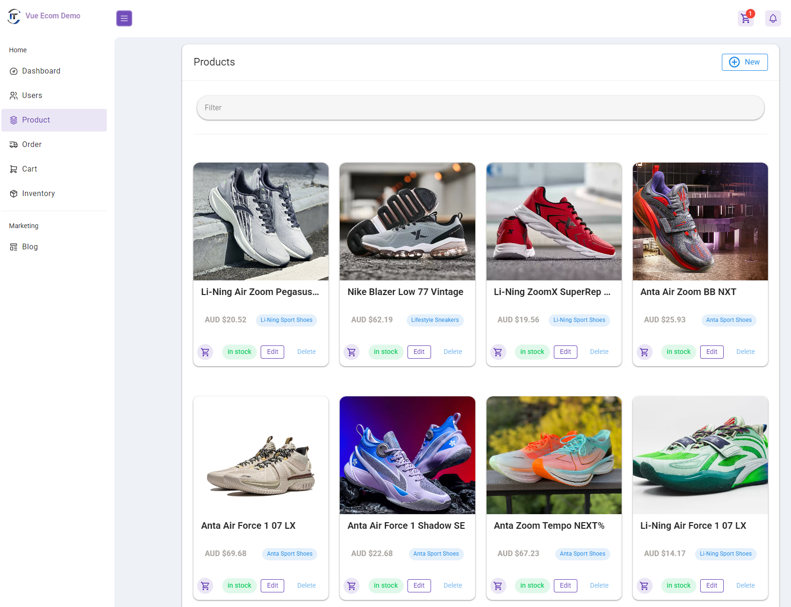
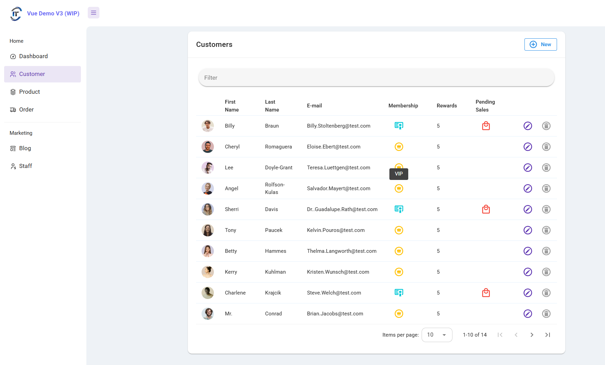
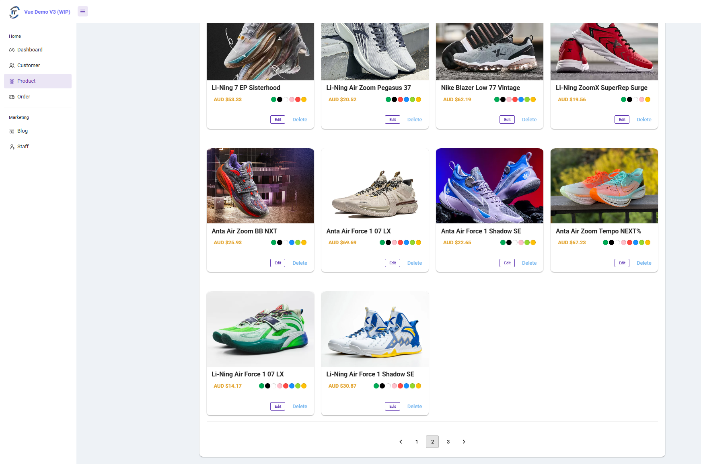
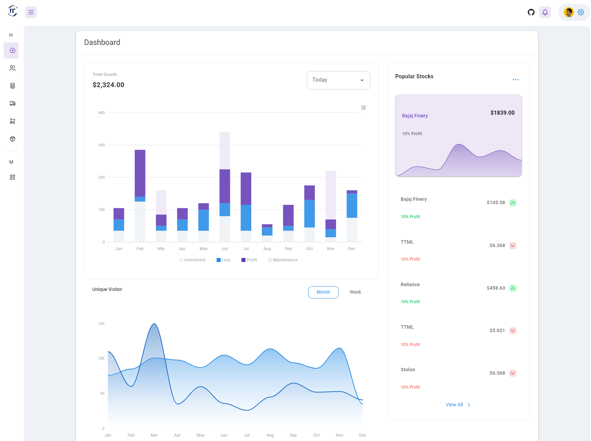
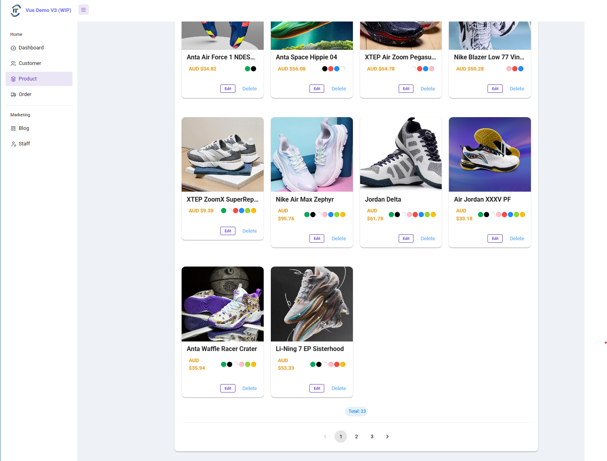
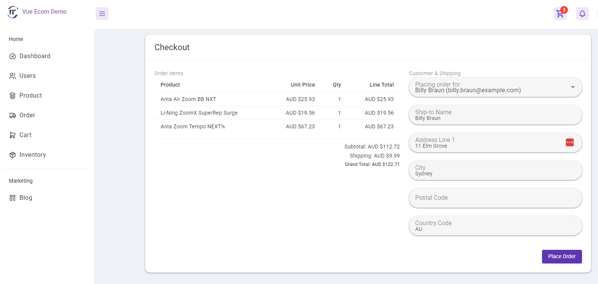
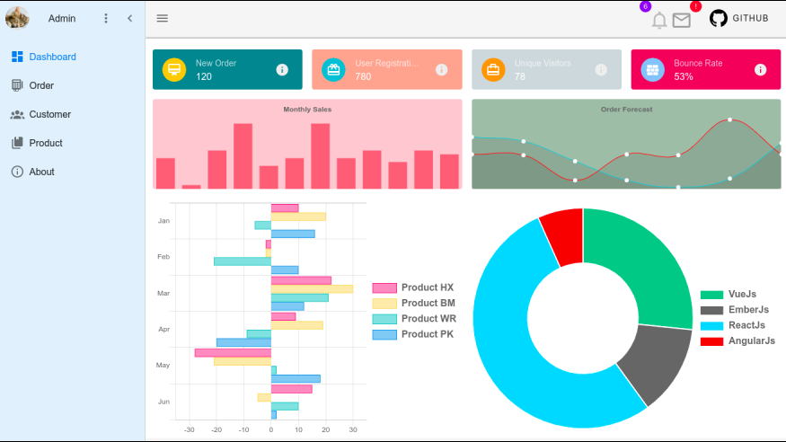
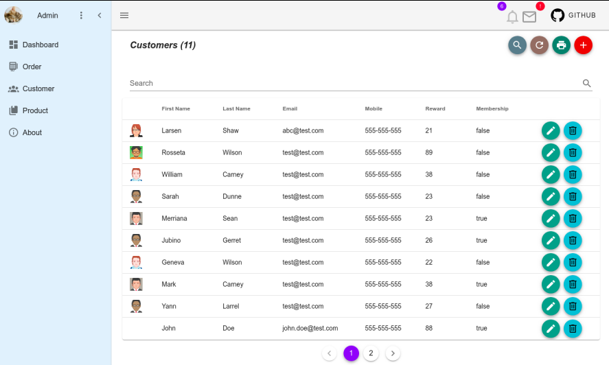
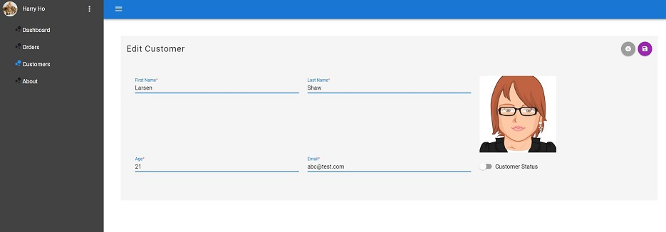
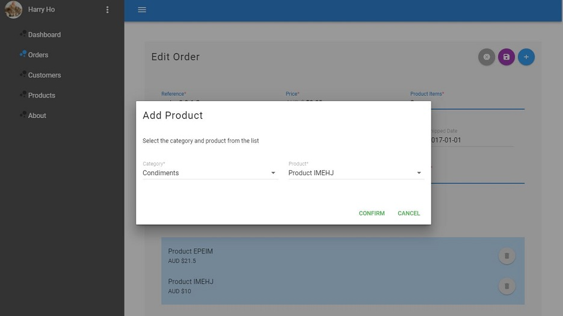

# Vue Ecom Demo

> A Vue 3 + Vuetify 4 ecommerce admin demo, built on Pinia for state and a plain in-memory data layer (no backend, no mock-service-worker/network layer required).

The goal of this project is to be a realistic, self-contained ecommerce admin demo: real domain modelling (users with addresses, categorized products with variants, orders with line items/status history/payments/shipments), a full customer-facing cart and checkout flow, and CRUD screens for the core entities - all backed by data that lives entirely in memory, so the app runs with zero backend setup.


### Features

* **Users** - full CRUD (list, create, edit, delete) with addresses, matching a real `User` domain model.
* **Products** - full CRUD with categories, variants, and stock levels; browse/filter/paginate, add to cart.
* **Orders** - real line items, a status timeline (pending → paid → shipped → delivered, or cancelled), and dedicated actions to record a payment, record a shipment, or mark delivered.
* **Cart & Checkout** - add products from the catalog, adjust quantities, pick the customer and shipping address, and place a real order against the in-memory data store.
* **Inventory** - a stock overview across every product variant, with low/out-of-stock indicators.
* **Dashboard** - the original template's widgets and charts (kept as-is; this is a demo, so the dashboard doesn't need to be backed by real analytics).

All of the above run against `src/data/repository.ts`, a plain async data layer over seed data in `src/data/ecommerce/` - there is no real backend, no mock server, and no network layer at all, by design.

### Live Demo

[Latest Demo App](https://vue-app-demo.harryho.org?timestamp=v3):  The demo is just a proof of concept. It doesn't have back-end API and all features of master branch.


### Screenshots

#### Latest Version

<!--  -->
<!--  -->

<!--  -->



#### Previous Version

[Previous version Demo App](https://vue-demo-v2.harryho.org?timestamp=v2):  The demo is just a proof of concept. It doesn't have back-end API and all features of master branch. Source code is availabe on a different [branch](https://github.com/harryho/vue-crm/tree/v2-vtf2)






<!-- 

 -->

## Build Setup

Requires Node >= 22. Uses [bun](https://bun.sh) as the package manager (a `bun.lock` is committed); `npm`/`yarn` should also work if you prefer, but aren't the primary supported path.

``` bash

# Clone project
git clone https://github.com/harryho/vue-crm.git
cd vue-crm

# install dependencies
bun install

# serve with hot reload at localhost:5173 (Vite's default)
bun run dev

# type-check
bun run typecheck

# run the test suite
bun run test

# production build
bun run build

```

## Docker 


```bash
## Run / Test release without building new image
bun run build

# Launch nginx image to test latest release
docker pull nginx:alpine
docker run -p 8080:80 -v \
    <your_aboslute_path>/dist:/usr/share/nginx/html nginx:alpine


# Build release image
docker build . -t  vue-demo:3.0

# Launch the development image in the backgroud
docker run --rm -d --publish 8080:80  --name vd3 vue-demo:3.0

# Check the log
docker logs vd3   -f

```


For detailed explanation on how things work, checkout following links

* [vue](https://vuejs.org/)
* [vuetifyjs](https://vuetifyjs.com/)
* [Pinia](https://pinia.vuejs.org/)
* [Vite](https://vite.dev/)
* [Vitest](https://vitest.dev/)


#### Change log

*  Jul 2026 - Uplift to Vue 3.5 + Vuetify 4 + Pinia 3 + Vite 8, and a full ecommerce domain-model rewrite: replaced the flat Customer/Order/Product demo with a real User/Category/Product/Order/Cart/Carrier/Staff model, added Cart/Checkout/Inventory, and gave Orders a real payment/shipment/status-history flow. Added a Vitest test setup (none existed before).

*  Mar 2025 - Uplift to Vue 3 + Vuetify 3 + Pinia is done.

*  Dec 2024 - Uplift to Vue 3 + Vuetify 3

* 2 May 2020 - Merge the branch vuetify-ts to master

    After the merge, the whole project moved to new techncial stack - TypeScript. Also, the VuetifyJs is upgraded to 2.x version. 


*  6 Dec 2018 - Create an archived branch json-server

    This branch was the master which used Json-Server as fake API. Considering the hiccup of setting Json-Server up and maintenance, it will be replaced by fake service ( Readonly fake API). You still can find and clone this branch with the name __json-server__, but it is no longer updated. It is an archived branch.


*  27 May 2018 - Rebase demo branch to master

    New master doesn't rely on Json-Server as fake API. It will only have Readonly fake API. It means any new or updated data will be stored to any physical file. All test data will be rolled back after system restart.


